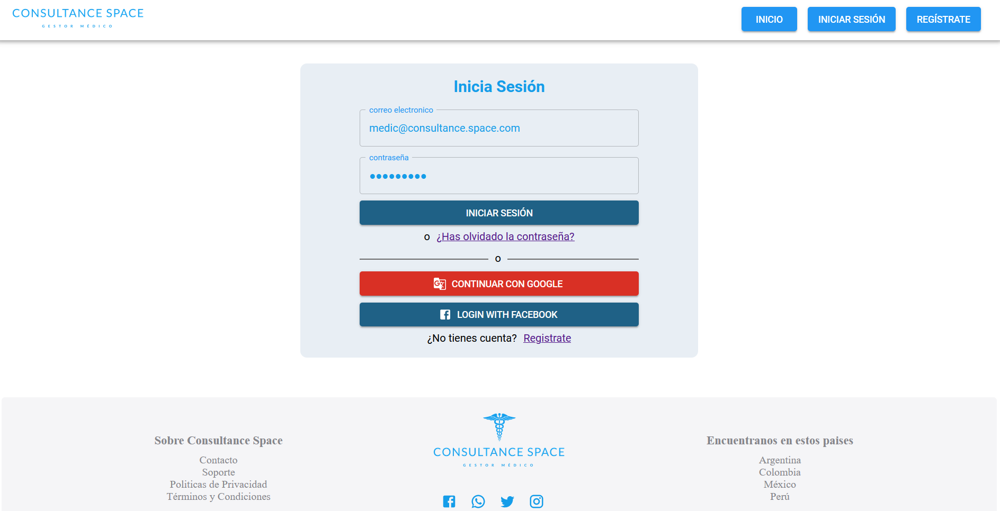

<p align="center">
  
</p>

# Consultance Space

Plataforma web de **gestión médica** que conecta a profesionales de la salud con sus pacientes: agenda de citas,
historia clínica, cobros con Mercado Pago, stock del consultorio y búsqueda de profesionales por especialidad.

> **Remake:** esta es la versión 2.0 de un proyecto hecho en equipo hace cinco años. El repositorio original está en
> [RodrigoToledo5/ConsultanceSpace](https://github.com/RodrigoToledo5/ConsultanceSpace).

> **Estado:** en desarrollo. La API valida identidad con Firebase y cobra con Mercado Pago; hace falta configurar tus
> propias credenciales para correrlo (ver [Puesta en marcha](#puesta-en-marcha)).

## Capturas

| Home | Login |
| --- | --- |
|  |  |

### Panel de administración responsive


## Qué permite hacer

**Profesionales**
- Registrar pacientes y llevar su **ficha médica** (antecedentes patológicos y no patológicos, tratamientos).
- Definir horarios y **agendar o cancelar citas**.
- **Cobrar** las consultas y ver el flujo de fondos (Mercado Pago, con conexión OAuth a la cuenta del profesional).
- Llevar el **stock** del consultorio.
- Suscripción al servicio, acreditada solo cuando el servidor confirma el pago.

**Pacientes**
- Buscar profesionales por especialidad y **reservar citas** en los horarios disponibles.
- **Pagar** las consultas online y cancelar citas.
- Consultar su historial médico.

## Stack

| Capa | Tecnología |
| --- | --- |
| Cliente | React 17, Redux (thunk), Material-UI v4, Formik, Recharts, React Router 5 |
| API | Node.js 20+, Express 4, Sequelize 6, Helmet, Nodemailer |
| Base de datos | PostgreSQL |
| Autenticación | Firebase Authentication (el servidor valida el ID token) |
| Pagos | Mercado Pago (OAuth, checkout y webhook) |
| Tests | Mocha, Chai y Supertest |

## Estructura

```
api/
  src/models/       Modelos de Sequelize (pacientes, citas, horarios, pagos, stock, antecedentes…)
  src/routes/       Endpoints por funcionalidad; las públicas, las autenticadas y las de email verificado
  src/middleware/   Validación del token de Firebase
  src/services/     Firebase y suscripciones
  tests/            Tests de modelos y de rutas
client/
  src/components/   Dashboard, pacientes, profesionales, pagos, login y registro
  src/redux/        Estado global
```

## Qué cambió respecto del original

El original (2021) funcionaba como proyecto de equipo, pero el servidor confiaba en los datos que mandaba el cliente.
En esta versión se reescribió la capa de seguridad y de pagos, y se actualizaron las dependencias:

| Tema | Original (2021) | 2.0 |
| --- | --- | --- |
| **Autenticación** | Las rutas no validaban quién llamaba: el servidor tomaba los ids del cuerpo del pedido | La API valida el **ID token de Firebase** en cada request y exige email verificado en las rutas privadas |
| **Permisos** | Sin control de acceso por usuario | Cada usuario solo accede a sus datos: un profesional ve a sus pacientes y sus citas, un paciente las suyas |
| **Pagos y suscripción** | La suscripción se acreditaba comparando un comprobante guardado | El servidor **consulta el pago a Mercado Pago** antes de acreditar, y hay un **webhook** (`/mp/webhook`) |
| **Credenciales** | Tokens de Mercado Pago y datos del mail escritos en el código | Todo en variables de entorno; la API arranca avisando qué falta y qué funcionalidad queda deshabilitada |
| **Seguridad HTTP** | CORS abierto a cualquier origen | `helmet` y CORS limitado al origen del cliente |
| **Errores** | Manejo disperso en cada ruta | Manejo central (`asyncHandler`, `httpError`) y utilidades compartidas (`dates`, `mailer`, `mercadopago`) |
| **Tests** | Tests de modelos | Tests de modelos, de rutas (validación, pagos, configuración) y del cliente |
| **Dependencias** | `react-scripts` 4, `axios` 0.21, SDK de Mercado Pago 1.x | `react-scripts` 5, `axios` 1.x, SDK de Mercado Pago 2.x, Node 20+ |
| **Cliente** | Un solo árbol de componentes | Vistas, contexto y hooks separados (`useProfileInfo`, `ViewContext`), cliente HTTP y configuración propios |

## Puesta en marcha

Requisitos: Node 20+ y PostgreSQL.

### API

```bash
cd api
cp .env.example .env   # completar DATABASE_URL, FIREBASE_PROJECT_ID, GMAIL_*, MP_*
npm install
npm run dev            # http://localhost:3005
npm test               # los tests de rutas no necesitan base de datos; los de modelos sí
```

Sin `DATABASE_URL` y `FIREBASE_PROJECT_ID` la API no arranca y dice qué falta. Sin `GMAIL_*` o `MP_*` arranca igual,
pero avisa qué funcionalidad queda deshabilitada. **Nunca se versionan credenciales**: solo los `.env.example`.

### Cliente

```bash
cd client
cp .env.example .env   # completar REACT_APP_FIREBASE_* y REACT_APP_API_URL
npm install --legacy-peer-deps
npm start              # http://localhost:3000
```

## Seguridad

- La API valida en cada request el **ID token de Firebase** (`Authorization: Bearer <token>`); `FIREBASE_PROJECT_ID`
  debe ser el mismo proyecto que usa el cliente. Cada usuario solo accede a sus propios datos (citas, historia
  clínica de sus pacientes, stock).
- Las suscripciones se acreditan solo después de que el servidor **consulta el pago a Mercado Pago** (`/addSub` con el
  `payment_id` y el webhook `/mp/webhook`). Para que el webhook funcione, `API_URL` debe ser una URL pública.
- La redirect URI de OAuth de Mercado Pago debe coincidir con `MP_REDIRECT_URI` (API) y con
  `<origen del cliente>/payments`.

## Equipo

[@RodrigoToledo5](https://github.com/RodrigoToledo5) · [@jescabvaz](https://github.com/jescabvaz) ·
[@MarlonLondono](https://github.com/MarlonLondono) · [@JorgeDGutierrez](https://github.com/JorgeDGutierrez) ·
[@Hasuro1797](https://github.com/Hasuro1797) · [@ftbalboa](https://github.com/ftbalboa)
